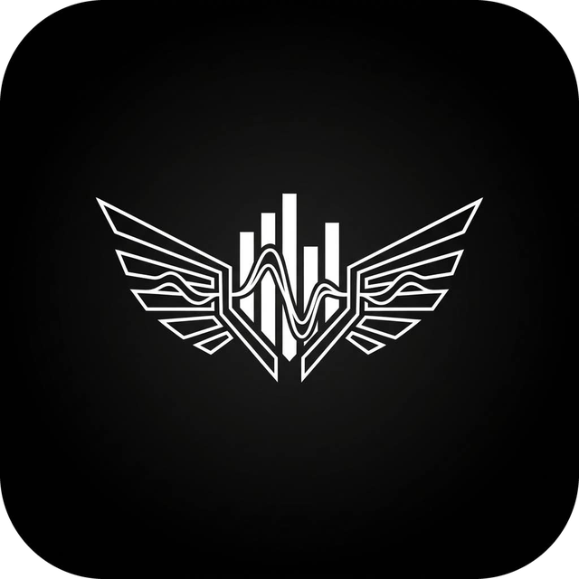

<div align="center">
  
  <h1>AngleMusic</h1>
  <p><strong>An open-source Android music player with a calm, glass-inspired interface.</strong></p>
  <p>
    <a href="https://github.com/nas1r0312-wq/anglemusic/releases/latest/download/AngleMusic.apk">
      
    </a>
  </p>
  <p>
    
    
  </p>
</div>

AngleMusic brings music discovery, playback, lyrics and your library together in one Android app. It is built with Kotlin, Jetpack Compose and Media3.

## Download

Get the latest APK from [Releases](https://github.com/nas1r0312-wq/anglemusic/releases/latest) or use the direct link: [AngleMusic.apk](https://github.com/nas1r0312-wq/anglemusic/releases/latest/download/AngleMusic.apk). It needs Android 8.0 or newer. Open the file on your phone and allow installing from your browser or file manager when Android asks.

## Features

- Browse and stream music through an InnerTube client, with background playback and Android Auto controls.
- Offline downloads, a local library, queues, playlists, sleep timer, playback speed and an equalizer.
- Crossfade, Automix and DJ-style transitions.
- Synchronized lyrics with word-level highlighting from several providers.
- Animated artwork and album-inspired colors.
- Local music and network shares (SMB and WebDAV), Spotify playlist import.
- Discord Rich Presence, Last.fm, music recognition and Listen Together.
- Frosted glass surfaces and adaptive layouts for phones and larger screens.

## Build locally

Requirements: JDK 21, Android Studio with Android SDK 37, and the Android NDK.

Open the repository in Android Studio and let Gradle sync, or build from a terminal:

```bash
./gradlew :app:assembleUniversalFossDebug
./gradlew :app:testUniversalFossDebugUnitTest
```

The `Foss` build omits Google Play services; the `Gms` build includes Google Cast support.

## Project structure

| Path | Responsibility |
| --- | --- |
| `app/` | Android application, screens, ViewModels, navigation, playback service and persistence. |
| `hig/` | Shared Cupertino-style controls, theme primitives and glass utilities. |
| `innertube/` | InnerTube client and models. |
| `lyrics/` | Lyrics providers and parsing. |
| `canvas/` | Animated canvas and catalog features. |
| `artwork/` | Artwork loading, caching and transitions. |
| `spotify/` | Spotify authentication and playlist import. |
| `integrations/` | Discord, Last.fm, music recognition and related integrations. |
| `network-storage/` | SMB and WebDAV music sources. |
| `spine/` | Add-on module hosting and lifecycle. |
| `listen-together-server/` | Server for Listen Together. |

## Contributing

See the [Contributing Guide](.github/CONTRIBUTING.md) and the [Code of Conduct](CODE_OF_CONDUCT.md). Questions and ideas go to [GitHub Discussions](https://github.com/nas1r0312-wq/anglemusic/discussions).

## Legal

AngleMusic is an independent project and is not affiliated with, endorsed by, or connected to YouTube, Google or their affiliates. Some features use unofficial third-party services, so use them at your own risk.

AngleMusic is licensed under the GNU General Public License v3.0. See [LICENSE](LICENSE) and [NOTICE](NOTICE) for the license and third-party attributions.
